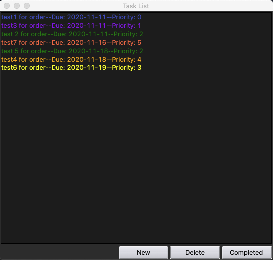
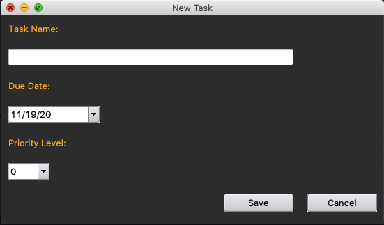

# Task List

A desktop task manager I built for my own use with Python, Tkinter, and PostgreSQL. It sorts tasks by due date and priority and color-codes them so the important things stand out.

## Why I built it
I couldn't find a task manager that fit my needs without extra features slowing it down, so I built my own. It was also a project to get better at building desktop interfaces with Tkinter. It originally ran on a Raspberry Pi with a local PostgreSQL database.

## Features
- Add tasks with a description, due date, and priority level from 0 to 5
- Tasks are color-coded by priority:

| Priority | 0 | 1 | 2 | 3 | 4 | 5 |
|---|---|---|---|---|---|---|
| Color | Blue | Purple | Green | Yellow | Orange | Red |

- Mark tasks complete. They're hidden from the list but kept in the database.
- Delete tasks, which removes them from both the list and the database

## How it works
Tasks are stored in a PostgreSQL table (see `DB.sql`). Adding, completing, or deleting a task updates the database, and the main screen then refreshes its list from the database, so what you see always matches what's stored.

## Tech
Python, Tkinter (ttk, ttkthemes, tkcalendar), PostgreSQL, psycopg2

## Run it locally
1. Create a PostgreSQL database and run `DB.sql` to create the `Tasks` table.
2. Install dependencies: `pip install psycopg2 tkcalendar ttkthemes`
3. Set your database connection settings <!-- as environment variables, once that change is made -->
4. Run `python TaskList.py`

## What I'd do differently
- Add an ID column to the Tasks table so tasks with the same name don’t conflict.
- Move database credentials into a local .env file that’s kept out of version control.
- Add a requirements.txt for easier setup.
